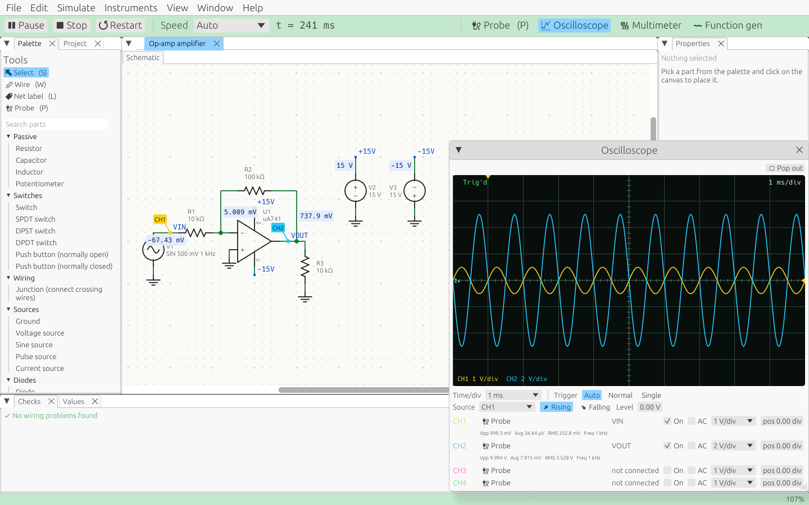
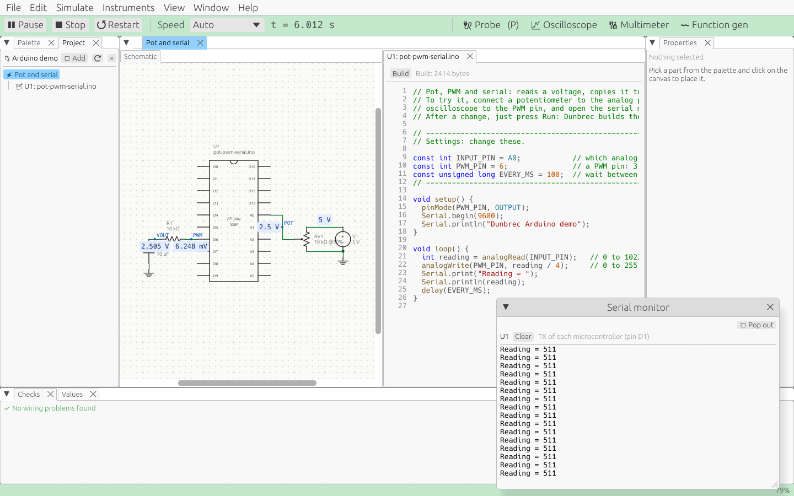
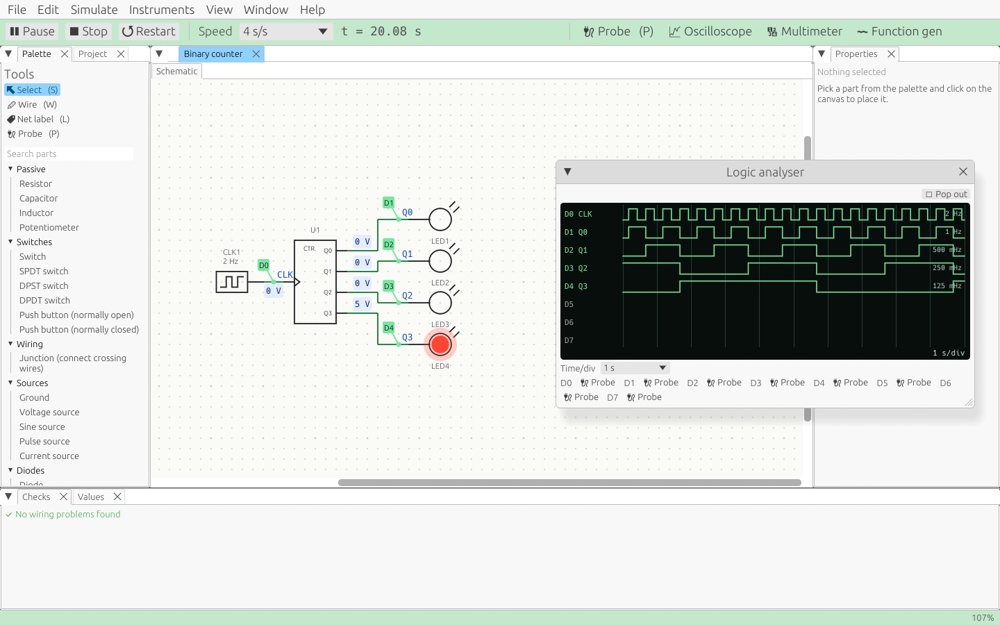

# Dunbrec

Dunbrec is a desktop electronics workbench for Windows. Draw a circuit, run it, and watch it work
with virtual instruments. Analog parts, digital logic and an Arduino-style microcontroller running
your own code can all share one circuit.

## Features

- **Draw circuits** with analog, digital, switch and integrated-circuit parts, including real
  transistors and diodes.
- **Simulate live**, and flip switches, turn potentiometers or change values while it runs.
- **Measure** with an oscilloscope, multimeter, function generator, Bode plotter, curve tracer and
  logic analyser.
- **Program a microcontroller** in Arduino C++ or assembly, then debug it and read its serial
  output.
- **Organise your work** in projects, with several circuits open at once.
- **Exchange designs** by importing SPICE and KiCad files and exporting to SPICE.
- **Ask an assistant** (optional) to help troubleshoot, and approve any change it suggests.

## Screenshots

**An Arduino sketch beside its circuit, with the serial monitor**

**Digital logic on the logic analyser**

## Development

Dunbrec is written in Rust. To build it, see the [development notes](docs/development.md).

## License

Copyright © 2026 CodeGator. Dunbrec is free software under the
[GNU General Public License, version 3 only](LICENSE), without any warranty. Copies obtained while
it was published under the MIT licence (before 2026-11-21) stay under that licence.
